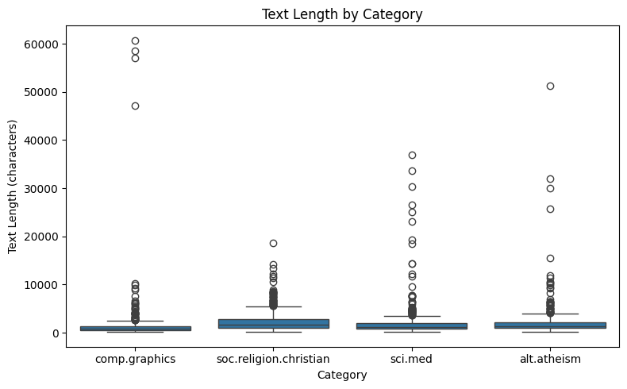
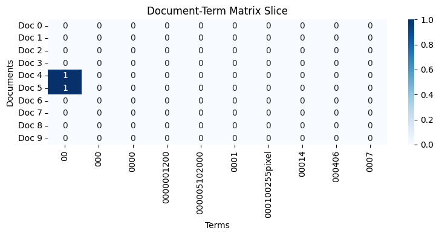
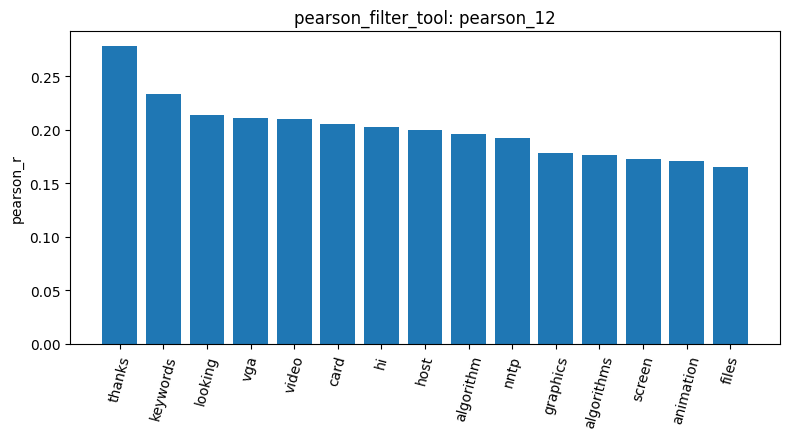
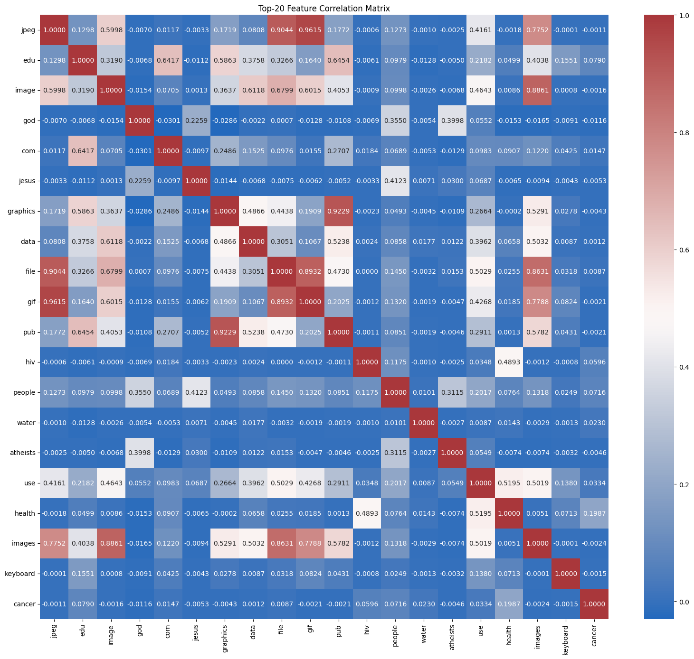
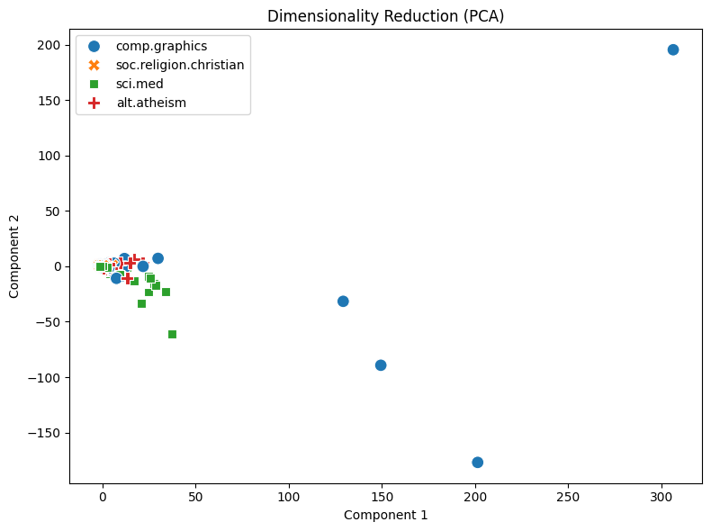

# Lab 1 Agentic Data Mining Pipeline Report

**Student Name:** 蔡承祐  
**Student ID:** RA7141236  
**Track:** Agentic Pipeline  

---

### 1. Dataset Exploration and Preprocessing Quality Assessment

The analysis began by retrieving 2,257 newsgroup postings across four target categories (`soc.religion.christian`: 599, `sci.med`: 594, `comp.graphics`: 584, `alt.atheism`: 480) via `load_dataset_tool` (`result_id`: `load_dataset_1`). Data sanitization steps performed through `check_missing_tool` (`result_id`: `check_missing_3`) and `check_duplicates_tool` (`result_id`: `check_duplicates_4`) verified that all 2,257 documents contain valid textual content with zero missing entries and zero exact duplicate documents. Text length profiling executed via `describe_data_tool` (`result_id`: `describe_data_5`) revealed an overall average document length of 1,992.96 characters (\(\sigma = 3547.66\)) with a median of 1,235.0 characters. As illustrated in the category boxplot below, the document length distributions are heavily right-skewed with extreme outliers across all four newsgroups, reaching a maximum length of 60,713 characters in `comp.graphics`.

---

### 2. Document-Term Matrix (DTM) Representation and High Sparsity Analysis

To represent textual records numerically, `build_dtm_tool` was invoked with standard English stop-word filtering (`result_id`: `dtm_2`). The resulting Document-Term Matrix maps the 2,257 documents across a vocabulary of 35,482 unique terms, yielding 258,503 non-zero entries out of 80,082,874 total matrix elements. This reflects an extreme sparsity of **99.68%**, demonstrating that individual documents utilize only a tiny subset of the global vocabulary. Global term frequency analysis via `term_frequency_tool` (`result_id`: `term_freq_7`) highlighted standard Usenet structural header tokens (`edu`: 4,675, `subject`: 2,464, `lines`: 2,353, `organization`: 2,192, `com`: 2,172) alongside salient topical terms such as `god` (2,216). A localized 10×10 slice visualized by `dtm_heatmap_tool` (`result_id`: `dtm_heatmap_8`) further confirmed this extreme zero-dominance across lexical coordinates.

---

### 3. Feature Filtering and Correlation Structure

To filter out non-informative noise, `variance_filter_tool` was applied with a threshold of 0.01 to prune near-constant features. Targeted feature relevance was evaluated via `pearson_filter_tool` (`result_id`: `pearson_12`) against a one-vs-rest binary indicator for `comp.graphics` at threshold \(r \ge 0.1\). Out of 35,482 candidate terms, exactly 188 features were retained while 35,294 low-correlation terms were discarded. The retained terms exhibited strong domain specificity, including `animation`, `bezier`, `bitmap`, `polygon`, `resolution`, `rgb`, `surface`, and `format`. The top 15 most correlated terms were visualized as a bar chart via `visualize_result_tool` (`result_id`: `pearson_12`), as displayed below:

Furthermore, pairwise correlation structure among the top 20 highest-variance terms was evaluated via `feature_correlation_matrix_tool` (`result_id`: `feature_corr_13`). The generated correlation heatmap reveals a distinct block-diagonal pattern: terms within the same semantic domain exhibit strong positive correlations (e.g., `jpeg` and `image` at \(r = 0.5998\), `keyboard` and `image` at \(r = 0.4643\)), whereas terms belonging to disparate domains show near-zero orthogonal correlations (e.g., `jpeg` and `cancer` at \(r = -0.0018\)).

---

### 4. Frequent Pattern Mining with PAMI FPGrowth

Frequent itemset mining was conducted on the 584 documents of category `comp.graphics` using `mine_patterns_tool` (`result_id`: `patterns_3`). Applying TF-IDF feature filtering in conjunction with the PAMI `fpgrowth` algorithm under a support threshold of \(\text{min\_sup} = 80\) identified **999 frequent itemsets**. The mined patterns capture pervasive document structures (e.g., `lines` + `subject` with support 584; `lines` + `subject` + `organization` with support 560) alongside frequent content-bearing co-occurrences such as `code` + `lines` + `subject` (support 80) and `files` + `organization` (support 89). These itemsets reflect standard Usenet communication headers and common programmatic discussions in graphics newsgroups.

---

### 5. Dimensionality Reduction, Label Encoding, and Document Similarity

Global geometric structure of the 35,482-dimensional vector space was evaluated through unsupervised dimensionality reduction via `reduce_dimensions_tool` (`result_id`: `reduction_4`) using 2-component Principal Component Analysis (PCA). The resulting 2D scatter plot demonstrates that documents from the same category form coherent clusters while preserving expected thematic proximities (e.g., theological discussions in `soc.religion.christian` and `alt.atheism` share partial projection overlap, while `comp.graphics` forms an isolated cluster). Category labels were transformed into a \(2257 \times 4\) binary indicator matrix via `binarize_labels_tool` (`result_id`: `binarize_labels_5`). Finally, pairwise vector proximity between the first two documents was quantified using `cosine_similarity_tool` (`result_id`: `cosine_sim_6`), yielding a cosine similarity of \(0.0582\). This low metric exemplifies the high angular orthogonality typical of sparse, high-dimensional text representations.

