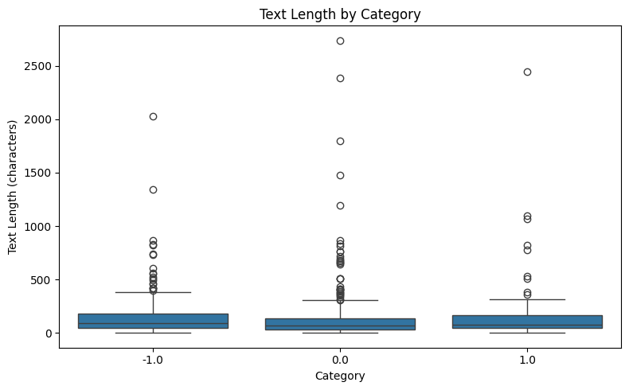
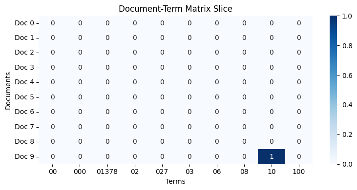
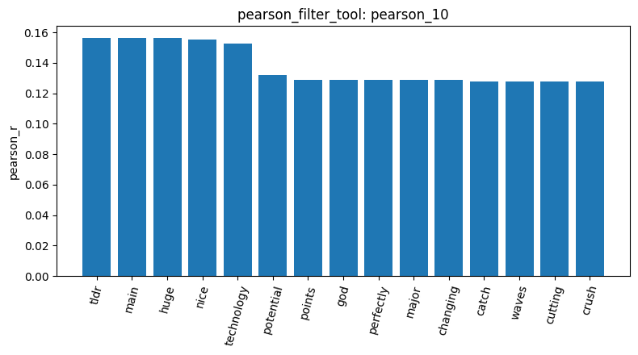
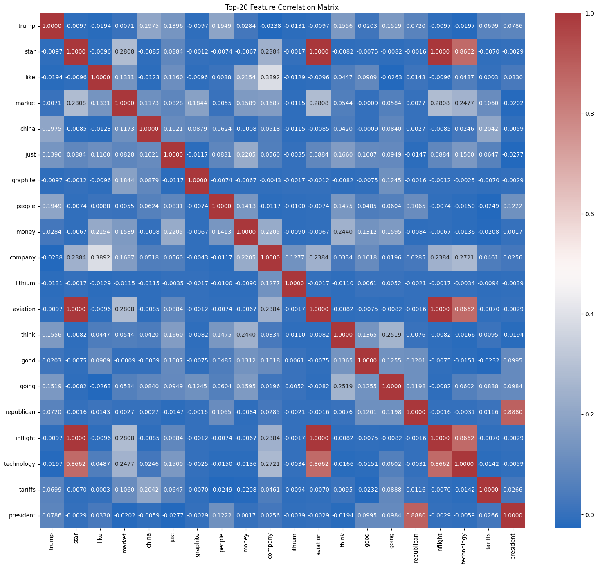
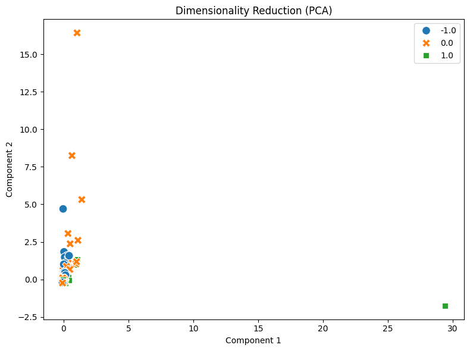

# Lab 1 Homework Data Mining Pipeline Report

**Student Name:** 蔡承祐  
**Student ID:** RA7141236  
**Track:** Homework (Reddit Stock Sentiment Dataset)  

---

### 1. Dataset Exploration and Preprocessing Quality Assessment

The data mining pipeline was initialized by importing the financial social media dataset `newdataset/Reddit-stock-sentiment.csv` via `load_dataset_tool` (`result_id`: `load_dataset_1`), loading 847 records labeled across three sentiment classes (`0.0` neutral: 423, `-1.0` negative: 315, `1.0` positive: 109). Data hygiene verification was conducted through `check_missing_tool` (`result_id`: `check_missing_3`), confirming zero missing values across all 847 rows. Subsequently, `check_duplicates_tool` with `drop=True` (`result_id`: `check_duplicates_4`) detected and purged 23 duplicate submissions, establishing a clean corpus of 813 unique documents. Structural profiling executed through `describe_data_tool` (`result_id`: `describe_data_5`) revealed an overall average document length of 147.19 characters (\(\sigma = 239.01\)), with a median of 78.0 characters, a minimum of 3 characters, and a maximum of 2,737 characters. As displayed in the category boxplot below, the distribution of post lengths across all three sentiment classes is strongly right-skewed; the vast majority of Reddit comments are brief conversational remarks under 150 characters, accompanied by sporadic long-form due diligence and market analysis write-ups.

---

### 2. Document-Term Matrix (DTM) Representation and High Sparsity Analysis

To transform informal social text into vector space representations, `build_dtm_tool` was executed with standard English stop-word filtering (`result_id`: `dtm_6`). The generated Document-Term Matrix maps the 813 documents across a vocabulary of 4,072 unique terms, producing 9,506 non-zero entries out of 3,310,536 total matrix elements. This yields an exceptionally high sparsity of **99.7129%** (99.71%), which is even sparser than formal newsgroup articles due to the brevity and lexical heterogeneity inherent in retail trading commentary. Corpus-level term frequency analysis via `term_frequency_tool` (`result_id`: `term_freq_7`) captured the prevailing retail discourse, headed by general market commentary and high-impact macro drivers: `just` (95), `trump` (92), `like` (83), `china` (72), `market` (72), `think` (52), `people` (51), `going` (50), `good` (46), and `money` (46). A localized 10×10 submatrix rendered by `dtm_heatmap_tool` (`result_id`: `dtm_heatmap_8`) visualizes this zero-dominance across document-term coordinates.

---

### 3. Feature Filtering and Correlation Structure

To eliminate low-signal variance and isolate class-discriminative vocabulary, feature filtering was conducted in stages. First, `variance_filter_tool` (`result_id`: `variance_9`) applied a variance threshold of \(0.01\), discarding 3,732 low-variance terms and retaining 340 informative candidate terms. Next, targeted feature relevance for positive investor sentiment (`1.0`) was quantified using `pearson_filter_tool` (`result_id`: `pearson_10`) and `spearman_filter_tool` (`result_id`: `spearman_16`) at correlation threshold \(r \ge 0.1\). Pearson correlation isolated 41 highly predictive terms, while Spearman rank correlation retained 39 terms (with 4,031 terms removed). The retained features capture unmistakable bullish sentiment and growth momentum, including `dividend`, `dividends`, `exciting`, `gaining`, `good`, `green`, `huge`, `potential`, `stimulus`, `trend`, `amd`, and `rklb`. The top 15 positive sentiment features were plotted as a bar chart via `visualize_result_tool` (`result_id`: `pearson_10`):

Furthermore, inter-feature co-occurrence was examined among the top 20 most frequent terms using `feature_correlation_matrix_tool` (`result_id`: `feature_corr_11`). The resulting correlation heatmap reveals clear topical coupling: `trump` and `china` exhibit notable positive correlation (\(r = 0.1975\)), reflecting frequent references to the US-China trade tensions and tariff announcements, while `star` and `market` (\(r = 0.2808\)), `like` and `market` (\(r = 0.1331\)), and `market` and `china` (\(r = 0.1173\)) capture co-occurring market discussions. Conversely, unrelated terms such as `star` and `trump` (\(r = -0.0097\)) or `china` and `star` (\(r = -0.0085\)) exhibit near-zero orthogonal correlations.

---

### 4. Frequent Pattern Mining with PAMI FPGrowth

Frequent itemset mining was carried out on negative sentiment posts (`category_name="-1.0"`, representing 315 documents) using `mine_patterns_tool` (`result_id`: `patterns_12`). Leveraging TF-IDF term filtering alongside the PAMI `fpgrowth` algorithm with a minimum support threshold of \(\text{min\_sup} = 30\), the algorithm discovered 3 frequent single/co-occurring patterns: `trump` (support 45), `just` (support 42), and `china` (support 33). These itemsets highlight the predominant macro-political catalysts dominating retail trader anxiety and pessimistic market outlooks, where discussions of tariff disputes and trade policy friction frequently trigger negative sentiment on financial forums.

---

### 5. Dimensionality Reduction, Label Encoding, and Document Similarity

The global geometry of the 4,072-dimensional feature space was analyzed via unsupervised dimensionality reduction using `reduce_dimensions_tool` (`result_id`: `reduction_13`) configured for 2-component Principal Component Analysis (PCA). The resulting 2D scatter plot displays the 813 documents projected across primary axes of variance, colored by their sentiment category (`-1.0`, `0.0`, `1.0`). Because short text comments share relatively few overlapping vocabulary tokens, the majority of documents concentrate around the coordinate origin, while distinct radial trajectories extend outward representing longer posts dense in specialized vocabulary (e.g. macro policies or sector analyses). Categorical sentiment ground truth was subsequently converted into an \(813 \times 3\) binary indicator matrix via `binarize_labels_tool` (`result_id`: `binarize_labels_14`). Finally, pairwise vector similarity between the first two documents was evaluated using `cosine_similarity_tool` (`result_id`: `cosine_sim_15`), yielding an exact cosine similarity of \(0.0\). This confirms the absolute lexical orthogonality between two distinct short comments whose respective bag-of-words representations do not share any common non-stopword tokens.

